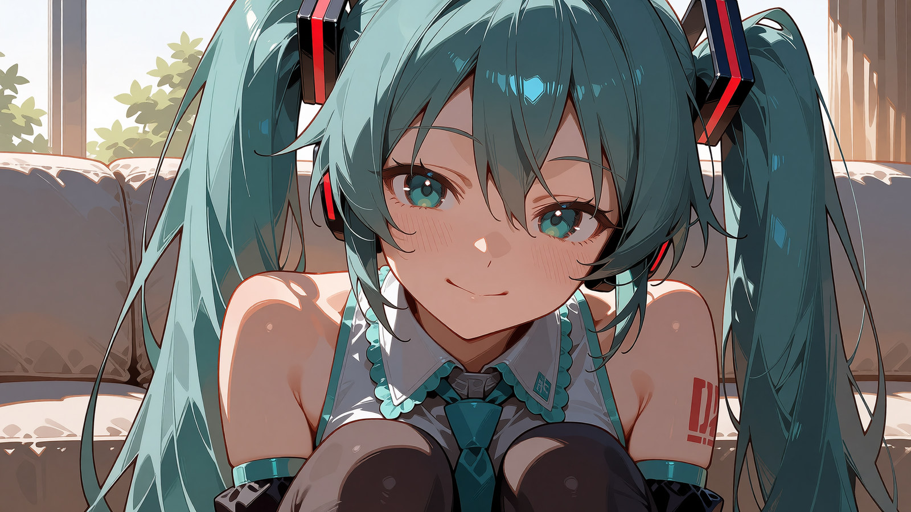
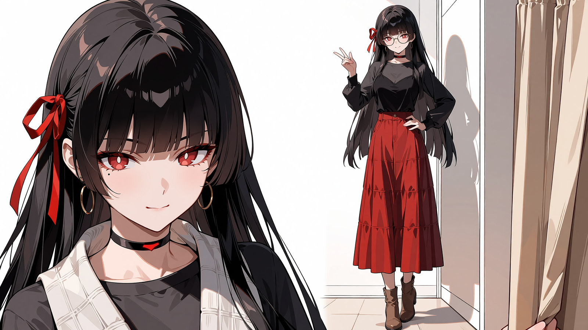
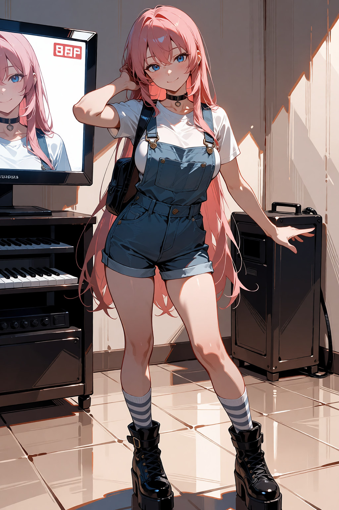
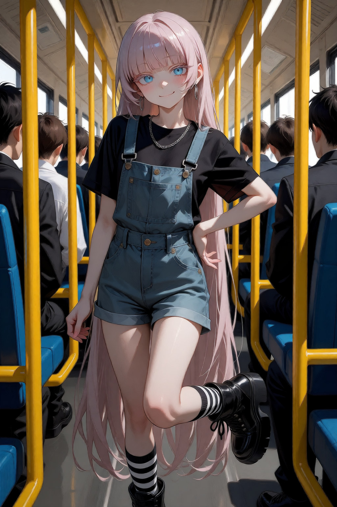
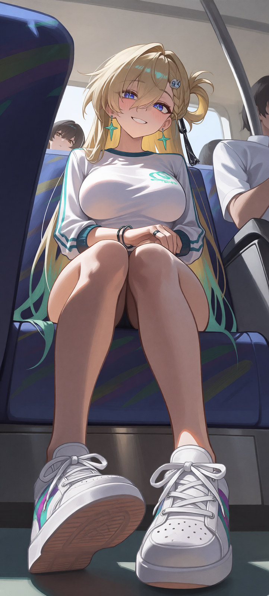
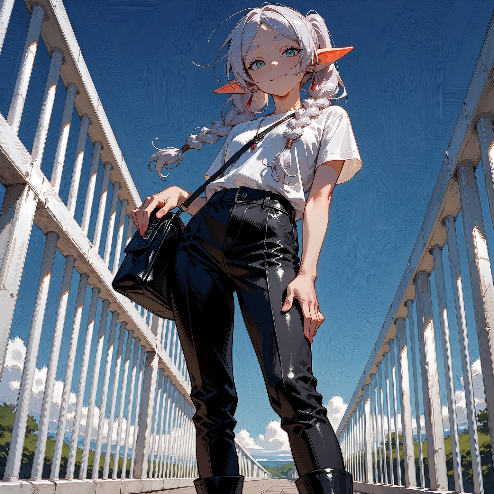
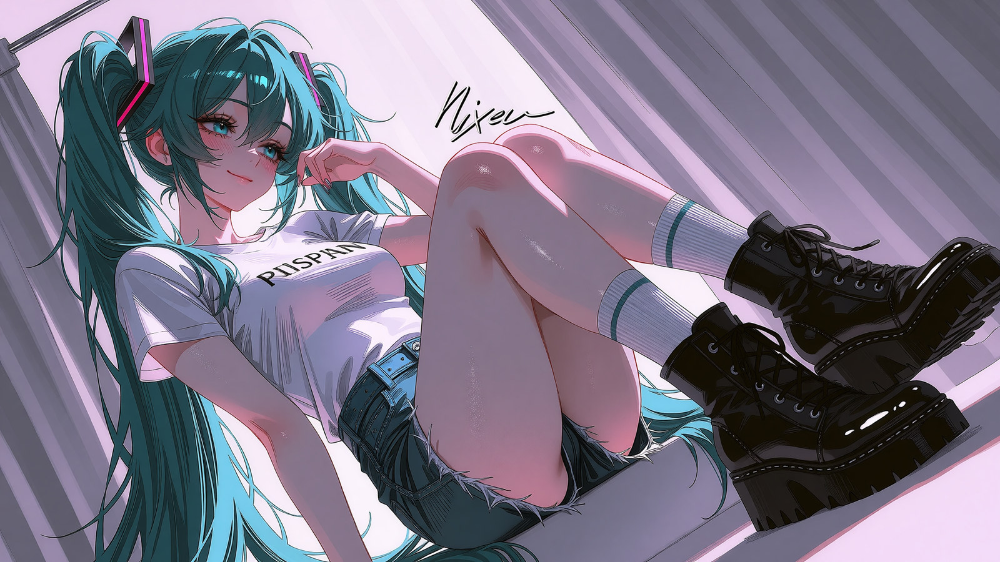
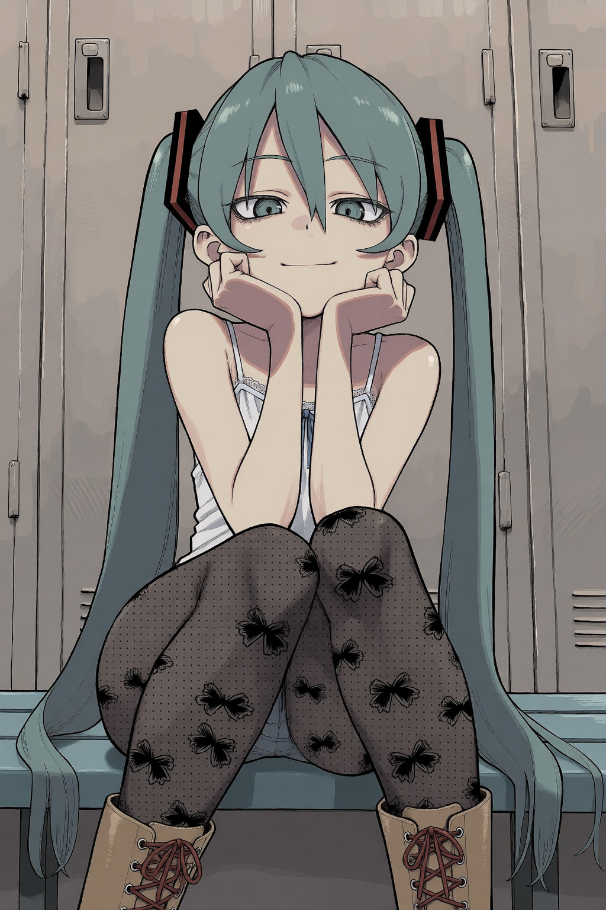
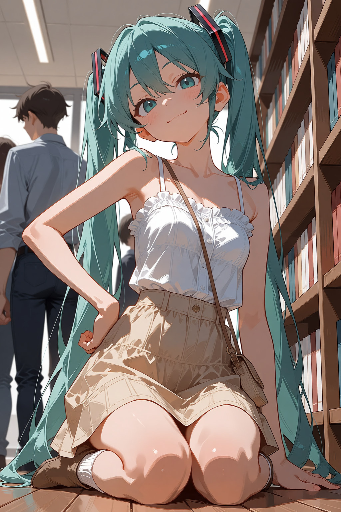

# anima 抽卡机

**一个跑在自己电脑上的动漫壁纸工厂。**

> ## ⚠️ 内容尺度声明
>
> **本仓库包含成人向内容。** 提示词的尺度分四档：`fashion`（日常）→ `tease`（擦边）→
> `exposed`（裸露）→ `sex`（成人向）。**默认只出 `fashion`**（`roll_params.py` 里四档权重
> 是 100/0/0/0），想开其它档自己在「抽卡机」面板里拖权重，或者改 `TIER_WEIGHTS`。
>
> - 使用前请自行确认所在地法律对成人内容的持有、生成与分发规定
> - 生成内容的一切责任由使用者承担：不得涉及未成年人，不得未经同意使用他人肖像，
>   不得用于违法用途
> - 作者不对任何人使用本项目生成的内容负责
> - **模型权重不在本仓库内**，Anima 受 CircleStone Labs Non-Commercial License 约束，
>   该许可独立于本仓库的代码许可
>
> 未满 18 岁请勿使用。

设定好角色、服装、场景、比例，让它整夜跑。第二天早上打开相册，几十上百张壁纸
已经在那儿了，挑喜欢的用。

---

## 为什么叫"抽卡机"

每张图都是一次组合的抽取结果。

一个角色有几十种服装、姿势、场景和十几种画风。代码把这些维度拆开，各自一个候选池，
按权重抽，冲突的自动驱逐——穿了裙子就不会再抽一条裤子，选了室内就不会再出现海边。

同一晚上跑一百张，一百个搭配，撞脸的概率很低。

---

## 我认为它好用的三个点

### 一、夜间跑完，早上直接挑

设定张数（比如今晚想要 80 张），点启动，去睡觉。

它一直画，画到张数够了或者撞上每日上限自己停。断点续传、失败记录（失败的图留在日志里，重抽队列能接着跑）、按日期分目录，
起来看相册就是现成的。

M4 Mac 上一张 1024×1536 大约 60 秒，RTX 4060 上 20 秒。
一晚上能出多少，取决于你愿意让它跑多久，上限自己设。

### 二、角色、衣服、场景，都能让 Agent 自己往里加

词库在你自己硬盘上，这是它和在线生图网站最本质的区别。

想要新角色，准备好官方立绘，照着 `新角色接入流程.md` 填三个地方——名字和特征、
性格标签、原皮服装，它就能画了。新的服装风格、场景、画风，都是纯 Python 列表，
往里加就行。

写这些不用你动手。仓库里的文档是写给另一个 AI Agent 看的：流程文件里写清楚了
改哪个文件、加在哪一行、加之前做什么校验。把仓库丢给你的 Agent，让它读
`新角色接入流程.md` 就行。

### 三、按格式填，基本不会崩

AI 生图最常见的三个崩：**多手多指、身体比例、服装穿模**。

做法是把提示词分层：角色特征一层、服装一层、姿势一层、场景一层、表情一层、机位一层，
每层管自己的事，层与层之间做冲突检测。拦住崩坏的是这个结构。

按格式填，崩坏率会低很多。零崩做不到，但至少不用每张都修。

---

## 出什么比例的图

壁纸是主业，比例这块做得比较细：

| 用途 | 尺寸 | 说明 |
|---|---|---|
| 手机 / iPad 竖屏 | 1024×1536 | 主力档，默认权重最高 |
| 全面屏手机 | 896×1984 | 9:19.5，超窄 |
| 电视 / 显示器 | 1536×1024 | 精确 3:2 横图，想要更宽的 16:9 自己在 `roll_params.py` 里加 |
| 头像 / 方图 | 1536×1536 | 社交平台 |

每种比例有权重，默认以竖屏为主，偶尔出一张横的调剂。想要哪种多一些，改权重就行，
相册的「抽卡机」面板里能直接拖。

---

## 怎么跑起来

两条路线，都在本地，不联网，不出别人的服务器。

相册服务默认绑 `0.0.0.0`（手机在局域网里能直接看）。**没设密码时，非本机请求一律 401**——
想让人从别的设备进来，先设一个：

```bash
export ALBUM_TUNNEL_PASSWORD='自己起一个'
python3 photo_server.py
```

不设也能用，只是别人连进来会被挡在外面。

**macOS** — Draw Things（App Store 免费） + `anima_turbo_v1.1_i8x.ckpt`
**Windows** — ComfyUI + 三件套模型（UNET / CLIP / VAE）

组词逻辑两边完全一样，差异只在最后那一步出图。

| | macOS | Windows |
|---|---|---|
| 出图引擎 | Draw Things | ComfyUI |
| 模型 | 单体 `.ckpt`（i8x 量化） | UNET + CLIP + VAE 拆三件 |
| 实测速度（1024×1536） | M4 16G ≈ 62 秒 | RTX 4060 8G ≈ 20 秒 |
| Python | 3.10+ | 3.11+ |

详细搭建步骤在 `skills/setup-macos/SKILL.md` 和 `skills/setup-windows/SKILL.md`，
那是写给 Agent 看的，照着走就行。参数差异见 `Win接口对照表.md`。

**切换引擎**：不用手动切 —— 代码自己认平台：macOS 上找到 `draw-things-cli` 就走 Draw Things，
否则走 ComfyUI（Windows 走这条）。想强制指定就设 `ROLL_ENGINE=drawthings` / `ROLL_ENGINE=comfyui`。
ComfyUI 的地址默认 `http://127.0.0.1:8188`，改了的话设 `COMFY_URL`。

**模型**：CircleStone Labs 和 Comfy Org 合作的 **Anima**，2B 参数，动漫向。
- HuggingFace：<https://huggingface.co/circlestone-labs/Anima>
- CivitAI：<https://civitai.com/models/2458426/anima>
- 国内可用 `hf-mirror.com` 镜像

> 🔴 **License 是 CircleStone Labs Non-Commercial License —— 非商业用途。**
> 它同时是 NVIDIA Cosmos-Predict2-2B 的衍生模型。商用前自己去模型原页看许可条款。
> 本仓库只是调用方，**不附带任何模型权重**。

---

## 先说 Windows

这个仓在 Windows 上没做过实机验证——作者手上没有 Windows 机器。

代码里留了跨平台的分支（引擎自动切 ComfyUI、进程控制走子进程），但能不能跑通得自己试。
遇到问题欢迎提 issue，麻烦把报错原文带上。macOS 那边的路径是走通了的，可以对照着看。

## 快速开始

```bash
git clone <本仓库地址> 抽卡机 && cd 抽卡机

python3 新自检.py          # 只读体检，七项
python3 photo_server.py    # 开相册，默认 8900
```

浏览器打开 `http://127.0.0.1:8900`，点「抽卡机」面板设张数和比例，点启动。
面板上的启动 / 停止在 macOS（launchd）和 Windows（子进程）上都能用。

想先验证不花显卡时间，可以只组词不画图（`--once` 后面要跟张数，不写就算 1 张）：

```bash
python -m pools.roll_machine --once 3 --nodraw   # 抽 3 条提示词，不出图
```

---

## 数据放在哪

**不用改路径。** 抽卡机落在哪个目录，相册就绑那个目录下的 `output/`：

```
PROJECT_ROOT  = 脚本所在目录                      paths.py:7
GALLERY_ROOT  = $ROLL_GALLERY 或 PROJECT_ROOT/output   paths.py:10
```

想放到别的盘（比如外置硬盘），设一个环境变量就够：

```bash
export ROLL_GALLERY=/Volumes/外置盘/生图输出
```

第一次跑时 `output/` 可能还不存在，服务会自己建；`新自检.py` 在这一步会提示「GALLERY_ROOT 不存在」，
建完之后再跑就正常了。

交给 Agent 装配时也一样——**让它把仓库放好、别去写死绝对路径**，其他都不用动。

## 仓库里有什么

```
pools/                  组词核心
  orchestrator.py       装配管线：分层叠加、冲突驱逐、最终拼串
  characters.py         角色库（默认只有样板初音）
  char_traits.py        性格标签
  roll_params.py        档位 / 尺寸 / 步数权重，默认配置在这
  roll_machine.py       主循环：批量出图、每日上限、单实例锁（pid 文件）
  roll_io.py            出图接口（按平台自动选 Draw Things / ComfyUI）
  backend_comfy.py      出图接口（ComfyUI）
  hairstyles.py         发型池 + 换发逻辑
  artists.py            画师 tag 池（`@名字` 前缀）
  styles.py             画风池 + 按档位分权重
  tier_classify.py      尺度分档（fashion / tease / exposed / sex，见下）
  preferences.py        口味样例（腋下/背身/成熟度这些偏好项，自己改）
  imgcheck.py           出图结果判定（认 PNG/JPEG 魔数，不拿体积当画质）
album/                  相册后端分模块
web/                    相册前端（纯静态，无构建步骤）
photo_server.py         相册服务入口（默认 8900）
paths.py                路径唯一来源（自定位 + 环境变量覆盖 + 平台/引擎判断）
tag_compose.py          词库组装 / 校验
works.py                作品（IP）名单
wardrobe.py             衣柜：服装池与搭配
pool_gate.py            词池闸门
make_versions.py        多尺寸出图
新自检.py               只读体检，七项
*.json                  七个词库数据文件（角色 / 画风 / 尺度 / 中文对照 …）
新角色接入流程.md       ← 加人物必读
Win接口对照表.md        两个平台的参数对照 + Windows 启停机制
CODE_MAP.md             代码地图
LAYERS.md               组词分层说明
skills/                 交给 Agent 的搭建流程
```

文档很多，遇到想不通的地方先翻 `CODE_MAP.md` / `LAYERS.md` / `新角色接入流程.md` 这三个。

---

## 加一个角色要做什么

三步，都在 `新角色接入流程.md` 里。有一条最要紧：**加之前先把官方立绘下下来看一眼**，
照文字描述猜配色，我们在这上面错过很多次。

```
pools/characters.py   名字 + 特征 + 原皮服装（CHARACTERS_SPLIT / DEFAULT_OUTFIT）
pools/char_traits.py  性格标签（成熟 / 可爱 / 无口 / 害羞，四类互斥）
```

仓库里只带了**初音未来**一条完整样例，三个地方都填好了，照着抄。

角色 tag 要带作品名。写 `roxy_migurdia (mushoku_tensei)`，光写 `roxy_migurdia`
底模不认，画出来是个路人。冷门角色底模没有认知的话，最后还是得训 LoRA。

**LoRA 不随仓库分发**：`LORA_MAP = {}`，`lora_of()` 恒返回空串。要用自己训一个写回去。

---

## 路径怎么配

**代码里没有任何绝对路径**，全靠 `paths.py` 自定位：

```python
PROJECT_ROOT = os.path.dirname(os.path.abspath(__file__))   # 项目在哪就是哪
GALLERY_ROOT = os.environ.get("ROLL_GALLERY") or PROJECT_ROOT/output
OUT_ROOT = GALLERY_ROOT                                     # 出图落盘 = 相册扫的同一个根
```

所以把它克隆到任何目录、任何用户名下都能直接跑，不用改代码。

想换图库位置（比如放外置盘）：

```bash
export ROLL_GALLERY="/Volumes/你的盘/抽卡图"
```

---

## 常见问题

**出图很慢 / 报找不到 draw-things-cli**
`paths.py` 会依次找环境变量和 `/opt/homebrew/bin/draw-things-cli`（装在 `/Applications` 里的 App 版本需要在设置里开「Allow CLI/API access」才有这个命令）。
装的是 App 但要命令行调用，得在 App 设置里开「Allow CLI/API access」，否则调不动。
Windows 上没有 `draw-things-cli`，引擎会自动走 ComfyUI —— 这时候要查的是 ComfyUI 有没有起、模型名对不对。

**ComfyUI 报 `invalid unet_name`**
模型名不能带目录前缀。文件在 `models/diffusion_models/` 下，但填的时候只写
`anima-turbo-v1.1.safetensors`。这条坑我们踩了半天。

**相册白屏**
先确认 8900 在监听；前端是纯静态的没有构建步骤，白屏一般是 JS 报错，开控制台看。

**画出来的人不是我要的角色**
先确认 tag 带作品名，再确认官方立绘的特征写法对。都不行就得训 LoRA。

**每日上限怎么改**
配置文件里的 `daily_cap`（软上限）和 `daily_cap_hard`（硬上限）—— 这个文件在相册面板里
保存过一次设置之后才会落盘，也可以自己写 `roll_config.json`。
到软上限自动停，手动点「启动」可继续；到硬上限当天彻底停工。

**能不能两个进程同时跑**
不能，有单实例锁 `_抽卡机.pid`，第二个会直接退出。这是故意的——
两个进程同时跑会让额度统计和权重全部失真。

---

## 尺度分档

每张图带一个档位，写在文件名或元数据里：

```
fashion   正常向（默认）
tease     擦边
exposed   露点
sex        Explicit
```

组词时会按档位切换词池与权重，相册也按档位筛。**默认只出 `fashion`**，其它三档权重是 0；
想要哪个档，把 `pools/roll_params.py` 里的 `TIER_WEIGHTS` 改掉就行。

只想留正常向的词，也可以直接删 `tag_library.json` / `tag_tiers.json` 里高档位的条目 ——
`tag_tiers.json` 的 `tags` 是「词 → 档位」的映射，照着删最省事。

## 例图

下面这些是这条产线跑出来的图，**缩图展示**（原图比这里大，横图原尺寸 1536×1024）。

### 横屏壁纸 · 1536×1024

<table>
<tr>
<td></td>
<td></td>
</tr>
<tr>
<td align="center"><sub>初音未来 · 客厅</sub></td>
<td align="center"><sub>小卡 · 城市街头</sub></td>
</tr>
<tr>
<td></td>
<td></td>
</tr>
<tr>
<td align="center"><sub>芙莉莲 · 山间花田</sub></td>
<td align="center"><sub>千咲 · 更衣室</sub></td>
</tr>
</table>

### 竖屏 · 窄屏 · 方图

<table>
<tr>
<td></td>
<td></td>
<td></td>
<td></td>
</tr>
<tr>
<td align="center"><sub>巡音流歌 · 1024×1536</sub></td>
<td align="center"><sub>七草荠 · 1024×1536</sub></td>
<td align="center"><sub>琳奈 · 896×1984</sub></td>
<td align="center"><sub>芙莉莲 · 1536×1536</sub></td>
</tr>
</table>

### 同一个角色，三种画风

<table>
<tr>
<td></td>
<td></td>
<td></td>
</tr>
<tr>
<td align="center"><sub>nixeu · 写实五官、厚重光影</sub></td>
<td align="center"><sub>琴山 · 粗线条、硬阴影</sub></td>
<td align="center"><sub>watercolor · 水彩晕染</sub></td>
</tr>
</table>

---

## License

代码采用 **MIT License**，全文见仓库根目录的 [`LICENSE`](LICENSE)。

**模型权重不在本仓库里**，Anima 受 CircleStone Labs Non-Commercial License 约束，
商用前自己去模型原页读许可条款。
